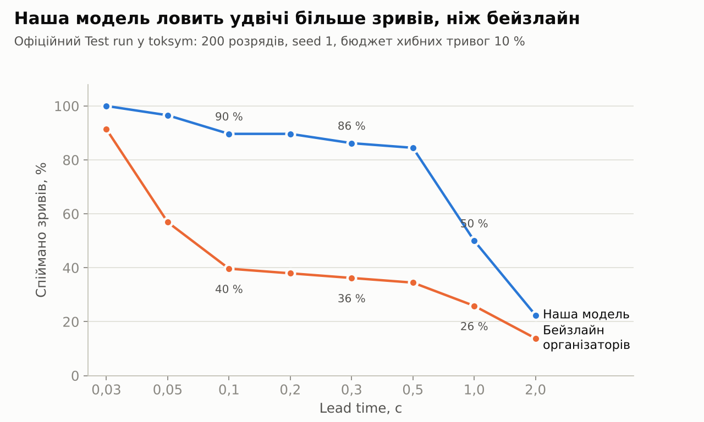
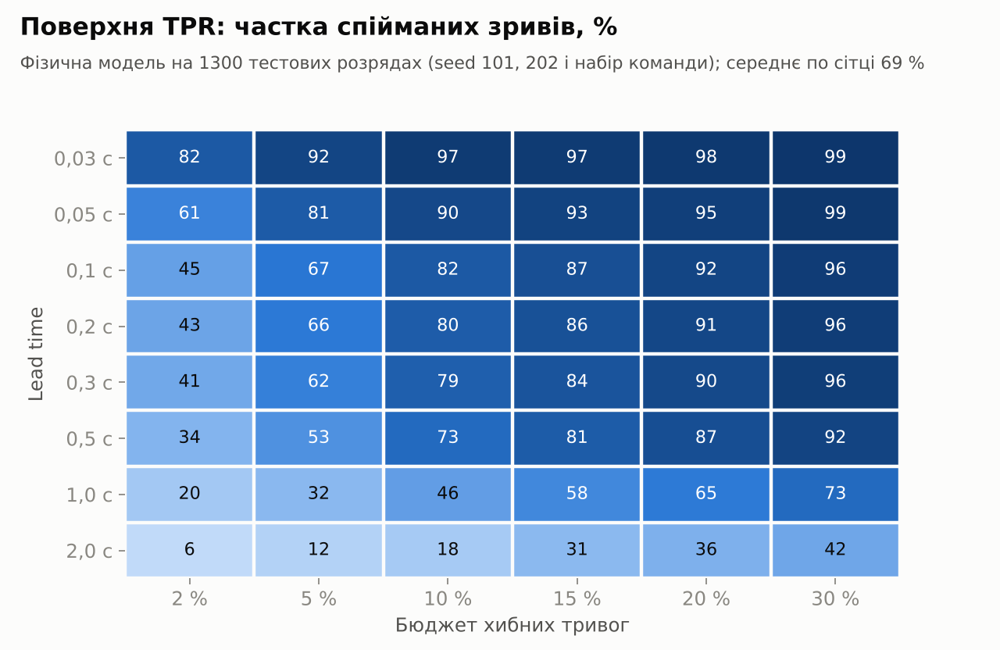
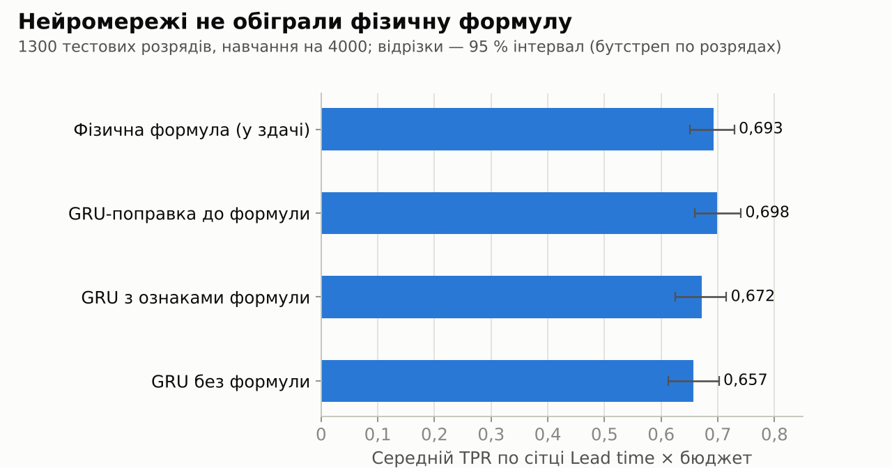
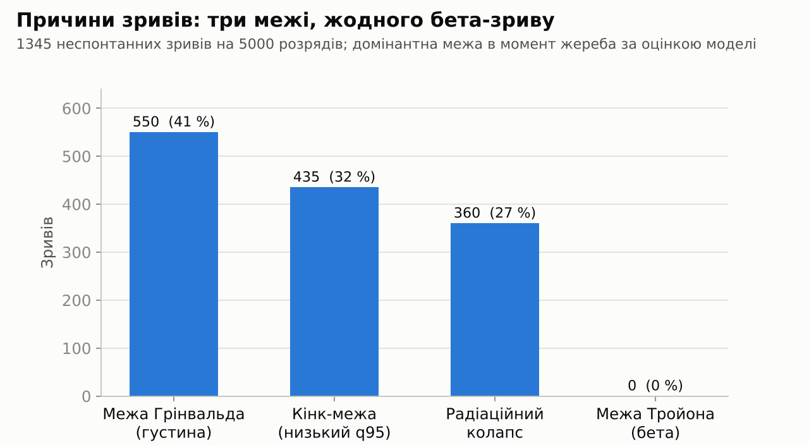
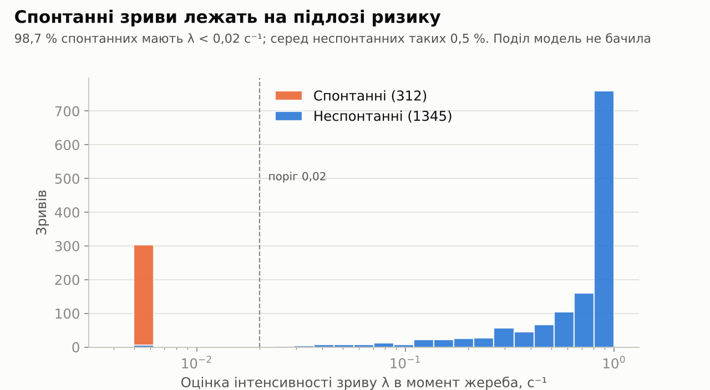
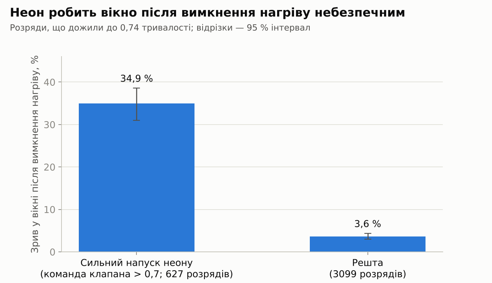
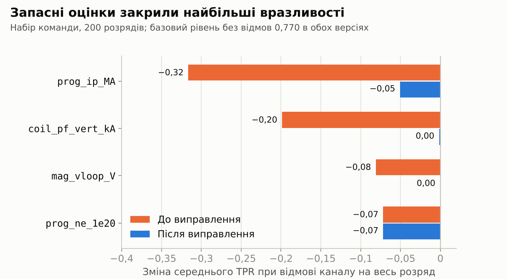

# Звіт: усе, що зроблено в проєкті

Хакатон «Код плазми» (ФМФ КПІ × Abitly), 9–11 жовтня 2026. Команда Lesychky.
Задача: раннє попередження зриву плазми в симуляторі токамака JET (`toksym`).

Цей файл описує все, що є в репозиторії: модель, дані, перевірені гіпотези, експерименти, скрипти й графіки.
Стан на 10 жовтня, 15:00.

## 1. Коротко

- У здачі — **фізична модель**: формула інтенсивності зриву із симулятора, обчислена з вимірюваних каналів,
  з чотирма константами, підігнаними на 4000 розрядів.
- Офіційний Test run (200 розрядів, seed 1, Lead time 0,3 с, бюджет хибних тривог 5 %): **42 з 58 зривів (72 %)**.
  Бейзлайн організаторів на тих самих розрядах: 17 з 58 (29 %).
- Середня частка спійманих зривів по сітці Lead time × бюджет на 1300 тестових розрядів: **0,693**.
- Перевірено **11 гіпотез** із критеріями, записаними до запуску: 7 підтверджено, 2 спростовано, 2 без чіткого вердикту.
- Нейромережі (GRU) і градієнтний бустинг порівняно з формулою на тих самих даних: підтвердженого виграшу вони не дали.



## 2. Задача

На кожному кроці 5 мс модель отримує сто вимірюваних каналів і повертає число p від 0 до 1 — імовірність близького зриву.
Тривога в розряді — перше перевищення порога. Вона має спрацювати за потрібний час (Lead time) до термічного гасіння
і не спрацьовувати на безпечних розрядах.

У симуляторі початок зриву — це жереб з інтенсивністю λ(t) на кожному кроці, тому точний момент передбачити неможливо:
відновити можна лише саму λ. Вона залежить від відстані до чотирьох операційних меж: Грінвальда (густина),
Тройона (бета), кінк-межі (низький q95) і радіаційного колапсу.

Фінальна оцінка організаторів: об'єм під поверхнею TPR у координатах «Lead time — частка хибних тривог» плюс пітчинг.

## 3. Модель у здачі (`submission/`)

Три файли: `model.py` (чистий Python, без бібліотек), `weights.json` (константи), `toksym.json` (маніфест).
Поточна версія — v2.2. Крок моделі триває близько 0,01–0,02 мс при ліміті 5 мс.

Що відбувається на кожному кроці:

1. **Пропуски.** Якщо прилад мовчить, береться його останнє справне значення.
2. **Стан плазми.**
   - Струм, поле, уставка густини й потужності нагріву беруться з каналів `prog_*`: у них немає шуму.
   - Густина наздоганяє уставку з затримкою 0,3 с; три хорди інтерферометра обмежують оцінку зверху.
   - q95 = q_a · (Bt/Ip) · (1 + q_b · κ²), де κ оцінюється як `coil_pf_vert_kA / Ip`.
   - Частка випромінювання = сума восьми болометрів / (нагрів + омічна потужність).
   - β_N рахується з діамагнітної петлі.
3. **Інтенсивність зриву λ.** Формула симулятора: чотири сигмоїди, куби, добуток, підлога 0,006 с⁻¹.
   На спаді струму (уставка нижче 90 % піку) і в першу секунду розряду λ = 0.
4. **Час до кінця небезпечної фази.** Програма розряду має сталу форму: плато струму починається на 0,15 тривалості,
   жереб вимикається на 0,82. Модель ловить вихід на плато і знає, скільки лишилося до спаду.
5. **Ризик L і ймовірність p = 1 − exp(−L).** L складається з трьох частин:
   - поточний стан: λ · час до спаду (не більше 3 с);
   - прогноз на 0,5 с: плазма напевно дійде до поточної уставки густини (вага 1), а нахил уставок може зберегтися (вага 0,35);
   - неон: якщо команда клапана неону перевищувала 0,7, додається ризик вікна після вимкнення нагріву.
6. **Locked mode.** Згладжений сигнал `mag_saddle_lm` вище 0,013 одразу дає p ≈ 1; це останні десятки мілісекунд.
7. **Запасні оцінки** (з v2.2), якщо канал мовчить від початку розряду: струм із `mag_ip_MA`,
   витягнутість із котушки форми, омічна потужність за законом Спітцера з температури ECE.

Константи у `weights.json`:

| Група | Значення | Звідки |
|---|---|---|
| Центри й ширини чотирьох сигмоїд | 1,0/0,08; 0,85/0,06; 0,9/0,05; 0,8/0,08 | методичка, без змін |
| `k_ne`, `k_rad`, `q_a`, `q_b` | 0,9716; 0,974; 2,2539; 0,1606 | максимальна правдоподібність на 4000 розрядів |
| Горизонт прогнозу, вага нахилу, стеля часу | 0,5 с; 0,35; 3 с | перебір на seed 101, контроль на seed 202 |
| Неон: поріг, ширина, імовірність | 0,7; 0,07; 0,4 | аналіз seed 101 |
| Locked mode: поріг, стала часу | 0,013; 0,02 с | аналіз seed 101 |
| Запасні оцінки (κ з котушки форми, P_ohm) | 0,2061; −0,079; 0,007; 0,513 | лінійна підгонка на seed 101 |

### Історія версій

| Версія | Що змінилося | Test run: seed 1, 0,3 с, 5 % |
|---|---|---|
| v1 | формула ризику; p = 1 − exp(−λ · час до спаду); locked mode; константи зі 100 розрядів | 44 з 58 |
| v2 | константи з 1200 розрядів; прогноз за уставками; неонове вікно; ігнорування першої секунди | 47 з 58 |
| v2.1 | константи з 4000 розрядів набору команди | 42 з 58 |
| v2.2 | запасні оцінки при відмові каналів | 42 з 58 |

Різниця між 42 і 47 лежить у межах розкиду на 200 розрядах: при бюджеті 5 % поріг стоїть на «сходинці».
По всій сітці v2 і v2.1 дають на цих розрядах 0,747 і 0,739.

## 4. Дані

Усі набори згенеровано `toksym gen`; той самий Master seed дає ті самі розряди.

| Набір | Seed | Розрядів | Роль |
|---|---|---|---|
| Перший тренувальний (від команди) | невідомий | 100 | версія v1 |
| Мій із колонками справжнього стану | 101 | 1200 | добір налаштувань v2, перевірка відновлення стану |
| Перевірочний | 202 | 600 | контроль і тест |
| Набір команди на 200 | невідомий | 200 | чистий тест |
| Набір команди: 500 | 101 | 500 | тест (це перші 500 розрядів набору на 1200) |
| Набір команди: 1000 | 102 | 1000 | добір епохи зупинки мереж; гіпотези O1–N1 |
| Набір команди: 2000 + 2000 | 105, 106 | 4000 | навчання; гіпотези O1–N1 |
| Стандартний Test run | 1 | 200 | офіційний звіт симулятора |

Набір команди відтворено з тих самих seed; `shots.csv` збігся з файлами команди байт у байт.
Самі `measured*.csv` у репозиторій не входять (сотні мегабайт кожен), `.gitignore` їх відсікає.

Властивості даних (`channels_report.csv`):
- відмови приладів ідуть серіями приблизно по 55 кроків, зачеплено 3 % рядків;
- шум близько 1 % від рівня сигналу плюс квантування;
- підсилення приладів плаває від розряду до розряду (NBI ±5 %, ICH ±11 %, хорди ±8 %);
- канали `prog_*` і команди клапанів шуму не мають;
- викидів, дублікатів і пропущених кроків часу не знайдено.

## 5. Результати моделі

Поверхня TPR на 1300 тестових розрядів (seed 101, 202 і набір команди на 200):



Порівняння з бейзлайном організаторів (`examples/submission`):

| Перевірка | Бейзлайн | Наша модель |
|---|---|---|
| Test run: seed 1, Lead time 0,3 с, бюджет 5 % | 17 з 58 (29 %) | 42 з 58 (72 %) |
| Середній TPR по сітці, seed 1 | 0,438 | 0,739 |
| Середній TPR по сітці, набір команди на 200 | 0,420 | 0,770 |

Різниця на наборі команди: +0,349, 95 % інтервал [+0,254; +0,467].

## 6. Порівняння з ML-моделями

Навчання на 4000 розрядів (seed 105, 106), добір епохи на seed 102, тест на 1300 розрядів.



| Модель | seed 101 | seed 202 | набір 200 | разом |
|---|---|---|---|---|
| Фізична формула (у здачі) | 0,685 | 0,675 | 0,768 | 0,693 |
| GRU-поправка до формули | 0,696 | 0,681 | 0,755 | 0,698 |
| GRU з ознаками формули | 0,655 | 0,665 | 0,735 | 0,672 |
| GRU без формули | 0,650 | 0,640 | 0,728 | 0,657 |

- Мережі мають від 1,9 до 5,4 тисячі параметрів, 22 входи, крок 50 мс.
- Градієнтний бустинг на 25 ознаках (перший експеримент, 1200 розрядів): 0,86 на навчальних розрядах і 0,49 на нових.
- З істинними густиною, випромінюванням і енергією замість виміряних формула дає 0,536 проти 0,530:
  точніше відновлення стану вже нічого не додає.

## 7. Гіпотези

Критерії записано й запушено до розрахунку (`hypotheses/THEORY.md`, `THEORY2.md`).
Невизначеність — бутстреп по розрядах.

### Твердження організаторів (з методички), 5000 розрядів

| № | Твердження | Що виміряно | Вердикт |
|---|---|---|---|
| O1 | Locked mode з'являється лише після жереба, не більше 0,1 с | 1 раннє спрацювання з 1655; медіана 0,045 с | підтверджено |
| O2 | На спаді струму зривів немає | 0 з 1657 | підтверджено |
| O3 | Бета-зривів немає | 0 з 1345 | підтверджено |
| O4 | Спонтанні зриви стаються біля підлоги ризику | λ < 0,02 у 98,7 % | підтверджено |
| O5 | Відмова одного каналу знижує якість менш ніж на 0,05 | чотири канали порушують поріг | спростовано |
| O6 | Причину зриву видно з вимірювань | збіг зі сценарієм 99,0 % | підтверджено |

### Власні гіпотези

| № | Гіпотеза | Що виміряно | Вердикт |
|---|---|---|---|
| N1 | Сильний неон веде до зриву після вимкнення нагріву | 34,9 % проти 3,6 %, відношення 9,6 [7,9; 11,9] | підтверджено |
| H1 | GRU без формули не гірша за фізичну модель | −0,036 [−0,066; −0,002] | спростовано |
| H2 | GRU-поправка покращує формулу на ≥ 0,02 | +0,005 [−0,013; +0,030] | не розрізнено |
| H3 | Перепідгонка на 4000 розрядів змінює результат | +0,007 [−0,006; +0,019] | не змінює |
| H4 | Ознаки формули потрібні мережі | +0,015 [−0,005; +0,031] | не підтверджено |







### Виправлення за спростованою O5



Після виправлення твердження O5 усе одно не виконується для двох каналів (`prog_ip_MA` −0,051, `prog_ne_1e20` −0,07),
але найгірше падіння зменшилося з 0,32 до 0,07. Якість без відмов не змінилася.

### Post-hoc спостереження (без наперед записаних критеріїв)

Повний перелік — у `hypotheses/POSTHOC.md` і наприкінці `RESULTS*.md`. Головні:
- оцінка на 100 розрядах ненадійна: та сама модель дала 0,69 на 100 і 0,51–0,53 на 600–1200 розрядах;
- екстраполяція нахилу уставок з повною вагою дає впевнені хибні тривоги, тому вага 0,35;
- зі зростанням навчальної вибірки з 1200 до 4000 розрядів GRU без формули піднялася з 0,61 до 0,66;
- перша оцінка ефекту неону («близько 50 % проти 5 %» на seed 101) була завищена.

## 8. Відомі обмеження

- **Розкид.** Стандартне відхилення середнього TPR: 0,04 на 200 розрядах, 0,03 на 600. Різниці менше 0,03 між моделями не розрізняються.
- **Малі бюджети.** При бюджеті 2 % модель ловить 41 % зривів за 0,3 с; безпечні розряди, що пережили високий ризик, неминуче дають хибні тривоги.
- **Довгі Lead time.** За 2 с до гасіння модель ловить 6–42 % залежно від бюджету: сценарій часто ще не почався.
- **q95.** Симулятор не віддає ні q95, ні витягнутості, тож формула q95 емпірична; константи `q_a` і `q_b` компенсують одна одну.
- **Неон.** Імовірність 0,4 у моделі вища за виміряні 0,35.
- **Поле `scenario` в `meta`.** Обгортка передає моделі назву сценарію розряду. Модель його не використовує.
- **Робоча точка** (Lead time і бюджет для захисту) командою ще не обрана.
- **Нейромережі й бустинг у `toksym` не запускалися:** вони оцінені нашим кодом на тих самих даних.

## 9. Що лежить у репозиторії

| Шлях | Що це |
|---|---|
| `submission/` | тека здачі: `model.py`, `weights.json`, `toksym.json` |
| `evaluate.py` | власна перевірка здачі на будь-якому наборі: таблиця TPR |
| `train.py` | підгонка чотирьох констант методом максимальної правдоподібності (numpy + pandas) |
| `clean.py` | причинна очистка каналів: пропуски, згладжування за типом приладу |
| `channels_report.csv` | шум, пропуски, квантування по кожному зі ста каналів |
| `hypotheses/THEORY.md`, `THEORY2.md` | критерії, записані до запуску |
| `hypotheses/RESULTS.md`, `RESULTS2.md`, `RESULTS3.md` | вердикти, таблиці, post-hoc |
| `hypotheses/POSTHOC.md` | спостереження першого дня |
| `figures/` | сім графіків із цього звіту |
| `research/` | дослідницькі скрипти (нижче) |

Скрипти в `research/`:

| Файл | Призначення |
|---|---|
| `pipe.sh` | відтворення набору команди з seed 102, 105, 106 і підготовка |
| `prep2.py`, `big.py` | читання CSV, розрахунок фізичних величин по всіх кроках |
| `vec.py`, `v3.py` | векторна версія моделі та оцінка поверхні TPR |
| `fit_hazard_mle.py` | перша підгонка констант (100 розрядів) |
| `final_prep.py` | перепідгонка констант на 4000 розрядів, ознаки для мереж |
| `final_train.py` | навчання трьох варіантів GRU |
| `nnprep.py`, `nntrain.py`, `nnmil.py`, `gb.py` | перші експерименти з мережами й бустингом (1200 розрядів) |
| `shotstats.py`, `verdict.py` | оцінка по розрядах, бутстреп, вердикти H1–H4 |
| `hyp2.py` | перевірка O1–O4, O6, N1 |
| `dead.py` | перевірка O5: вимкнення каналів |
| `harness.py`, `rj.py` | покроковий прогін моделі; розбір звіту `toksym` |
| `figs.py` | побудова графіків |

## 10. Як відтворити

```
# перевірити й прогнати здачу в симуляторі
./toksym check submission
./toksym score --submission submission --shots 200 --seed 1 --lead 0.3 --budget 0.05

# згенерувати набір команди
./toksym gen --shots 2000 --seed 105 --out s105
./toksym gen --shots 2000 --seed 106 --out s106

# власна перевірка і підгонка констант
python evaluate.py measured.csv shots.csv submission
python train.py measured.csv shots.csv submission/weights.json
```

## 11. Що лишилося зробити

1. Уточнити в менторів список «гіпотез організаторів» з афіші; тут ними вважаються твердження методички.
2. Обрати робочу точку (Lead time і бюджет хибних тривог) та обґрунтувати її.
3. Підготувати презентацію і пройтися по `model.py` всією командою.
4. Прогнати здачу в Test run на ноуті команди й зберегти звіт.
5. Змерджити гілку `physics-hazard-v1` у `main`.
